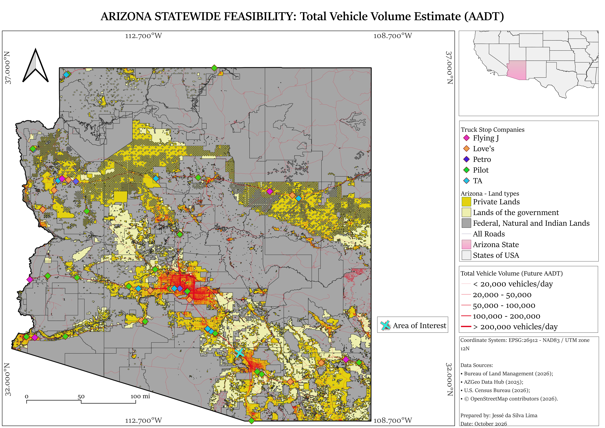
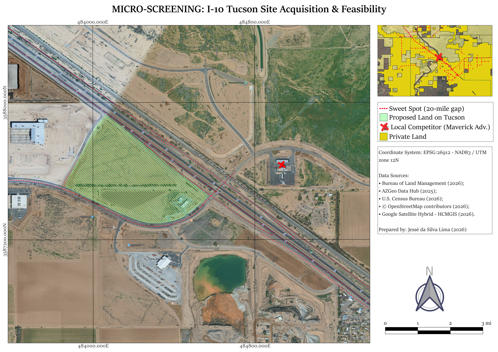

[🇺🇸 English](README.md) | [🇧🇷 Português](README-pt.md)

# Análise-GIS-para-Triagem-Locacional-de-um-Potencial-Truck-Stop-no-Arizona
### Pesquisa  da Viabilidade para a Construção de uma Truck Stop

---

## 1. Contextualização e Objetivo
* O estado do Arizona, localizado nos Estados Unidos, possuí alta presença de Truck Stops devido a sua alta dependência do tráfego rodoviário, tendo em vista a formação geológica e disposição geográfica dos terrenos. Isso faz com que a geolocalização para a construção de um novo posto de combustível para atender caminhões de grande porte seja realizada através de um estudo territorial, devendo ser observado não apenas a viabilidade de aquisição do terreno e capacidade em comportar a construção, mas também o fluxo de carretas e caminhões, além do risco de desastres naturais. O sul e o sudoeste do estado (onde ficam Phoenix e Tucson) são formados por vales desérticos de baixa altitude (como o Deserto de Sonora). Embora passe a maior parte do ano extremamente seco e quente, o sul sofre com enchentes repentinas severas (flash floods) em duas épocas específicas (verão e inverno), necessitando que o terreno selecionado seja categorizado como seguro de acordo com a FEMA Flood Map Service Center.
* O objetivo desse repositório foi demonstrar competências aplicáveis à função de GIS & Land Feasibility Analyst da KND Fuels por meio de um fluxo de análise espacial em escala estadual e de uma investigação local na região de Tucson.
* O trabalho combina dados de tráfego, ETL em python, imagens de satélite, camadas territoriais, localização de concorrentes e triagem de viabilidade do terreno mediante a análise de risco de eventos e desastres naturais, tais como enchentes (FEMA).
---

## 2. Área de Estudo e Dados Selecionados

* Recorte Espacial: Estado do Arizona, EUA.
* Ano de Referência: 2025/2026
* A seleção dos indicadores não foi feita pela simples disponibilidade dos dados, mas sim ao buscar fontes que forneçam informação confiável e de qualidade para auxiliar na tomada de decisão em busca de uma área para a construção de um Truck Stop. 
* Os dados foram buscados a partir de algumas necessidade:
  - Contextualização territorial: organizar camadas de situação das terras para distinguir, em nível exploratório, áreas privadas, públicas e categorias com restrições específicas à aquisição privada convencional.
  - Leitura do tráfego: comparar o volume total estimado de veículos com indicadores de tráfego comercial de longa distância e regional.
  - Mapeamento da concorrência: reunir 59 pontos obtidos por consulta automatizada à Overpass e 11 pontos complementares pesquisados manualmente (com base em fontes oficiais e pesquisa exploratória em imagens de satélite), totalizando 70 pontos identificados antes da validação final de duplicatas e atributos.
  - Análise de proximidade: construir e dissolver buffers de 20 e 30 milhas ao redor dos pontos de concorrentes.
  - Diferença espacial: destacar segmentos e áreas fora das zonas de influência geométrica definidas pelos buffers e interpretá-los em conjunto com as camadas de tráfego.
  - Priorização e inspeção local: análise das áreas fora das zonas de influência a partir do buffer para aprofundar a análise e selecionar o terreno escolhido.
  - Triagem de restrições: sobrepor as zonas de inundação da FEMA para evitar a seleção de áreas de alto risco.

* Os dados utilizados foram:
  - **Bureau of Land Management (2026):** Utilizado para o mapeamento fundiário, delimitando terras privadas, governamentais, reservas indígenas e áreas federais.
  - **AZGeo Data Hub (2025):** Fonte principal para as métricas de transporte, fornecendo os dados de Volume Médio Diário Anual (AADT) para tráfego comercial de longo curso, caminhões de unidade simples e estimativas totais de veículos.
  - **U.S. Census Bureau (2026):** Aplicado para a estruturação das malhas territoriais e limites estaduais/municipais do Arizona.
  - **OpenStreetMap contributors (2026):** Base vetorial empregada na extração da malha rodoviária, vias de acesso e geolocalização da infraestrutura de concorrentes do setor (Flying J, Love's, Petro, Pilot, TA).
  - **FEMA - National Flood Hazard Layer (2026):** Utilizado na validação ambiental do terreno, mapeando as classes de risco de inundação (como as zonas seguras X e as zonas de risco A/AE) para garantir a segurança da infraestrutura.
  - **Google Satellite Hybrid / HCMGIS (2026):** Forneceu as imagens orbitais de alta resolução para a visualização do lote proposto em Tucson e das áreas adjacentes na escala de micro-triagem.
---

## 3. Produtos Cartográficos 
### 3.1 Território do Arizona: Terra, Competidores e Fluxo Rodoviário

* Inicialmente, o estado do Arizona foi classificado em três áreas (território privado, governamental e federal). Além disso, houve inserção dos pontos correspondentes aos principais concorrentes no ramo de truck stop e paradas para caminhoneiros. Essa divisão é composta pela camada "BLM_AZ_Surface_Management_Agency" do Bureau of Land Management (2026), sendo composta pelos seguintes grupos:
* - **Private Lands:** Private lands only.
  - **Lands of the Government:** County, State, Other.
  - **Federal, Natural and Indian Lands:** Bankhead-Jones Act, BLM, BR, Indian Lands, Local or State Parks, Military, NPS, State Wildlife Area, USFS, USFSW.
* A análise de viabilidade estadual do Arizona revela que a maior concentração de tráfego ocorre na capital, Phoenix, que registra o fluxo rodoviário mais intenso do estado, com trechos superando 200.000 veículos diários. O segundo polo de maior volume localiza-se em Tucson, a segunda cidade mais populosa, formando um corredor logístico de alta densidade entre os dois grandes centros urbanos. Essa dinâmica foi quantificada a partir das métricas do AZGeo Data Hub publicadas em 2025, que projetam a estimativa do Volume Médio Diário Anual de Veículos (Future AADT) para o ano de 2026, calculadas com base no histórico de comportamento do fluxo rodoviário de anos anteriores.

### 3.2 Fluxo Rodoviário: Fluxo de Caminhões de Unidade Simples

* A análise do tráfego comercial regional foca nos caminhões de unidade simples (Single-Unit Trucks), veículos de carga de estrutura rígida sem articulação. O mapa demonstra que a densidade desse tipo de frota está fortemente concentrada nas zonas metropolitanas para distribuição local, com a região de Phoenix registrando alto fluxo de caminhões diariamente.
* Tucson desponta como o segundo maior polo, apresentando trechos urbanos e periurbanos com tráfego variando de 10.000 a mais de 20.000 veículos por dia. Além da circulação interna das cidades, o eixo rodoviário que interliga Phoenix a Tucson sustenta um fluxo contínuo e elevado, mantendo volumes expressivos entre 4.000 e 10.000 caminhões diários. Isso evidencia a vitalidade estrutural desse corredor específico para a logística regional de curta e média distância no estado.

### 3.3 Objetivo Comercial Através de Fluxo Rodoviário & Buffer para Análise da Área de Influência

* O tráfego comercial de longo curso foca-se nos veículos articulados pesados (Combination Trucks), essenciais para a logística interestadual e de grandes distâncias. O mapeamento revela que as principais artérias de escoamento atravessam o estado, mas o maior eixo de concentração rodoviária interliga, de forma expressiva, as áreas metropolitanas de Phoenix e Tucson.
* Esta métrica demonstra a elevada dependência desta rota para o transporte de mercadorias e viabiliza o corredor I-10 como a zona de maior viabilidade estrutural para a intercessão do tráfego pesado de longa duração. Devido ao objetivo proposto da construção de um Truck Stop, a análise do fluxo de caminhões articulados é de suma relevância por indicar potenciais clientes.

Com base no exposto, realizei um buffer de 20 e 30 milhas dos losangos do mapa, correspondentes aos principais competidores mapeados através de [API em Python](arizonaproject.ipynb) com dados do OpenStreetMap, da localização dos sites oficiais e de inspeção através de imagens de satélite do Google.

* O processamento espacial consistiu na criação de buffers de 20 e 30 milhas de raio ao redor de cada concorrente previamente mapeado, representando as principais redes do setor. Utilizou-se a operação de dissolver (dissolve) para unificar os polígonos que se intersectavam, resultando em uma mancha contínua que delimita a zona de influência comercial já consolidada no estado.
* A partir dessa delimitação geométrica, aplicou-se uma ferramenta de diferença espacial entre a camada de volume de tráfego comercial pesado (Heavy Truck Volume) e a área de abrangência unificada dos buffers.

* O mapa de Market Gaps consolida a operação espacial de exclusão. As linhas pontilhadas delimitam os vazios mercadológicos identificados, categorizados como "Sweet Spot" (gap de 20 milhas entre concorrentes, em vermelho vivo) e "Crowded Market" (vazios superiores a 30 milhas, em vermelho escuro).
* A análise cartográfica comprova que o corredor da I-10, posicionado a noroeste de Tucson, apresenta a convergência estrutural ideal: altíssima densidade de tráfego logístico (AADT > 10.000 caminhões/dia) inserida exatamente em um "Sweet Spot" de 20 milhas livre da influência direta da concorrência mapeada. Este cruzamento de dados empíricos fundamenta geograficamente a escolha da região para a prospecção em microescala.

### 3.4 Análise de Viabilidade e Seleção do Terreno

* Definido o raio de interesse na I-10, a avaliação seguinte exigiu a validação de segurança ambiental perante os riscos hidrológicos. Através da camada do National Flood Hazard Layer (FEMA) referente ao ano de 2026, mapearam-se as classes de perigo de inundação para o estado do Arizona da seguinte forma:
* - **Zonas A, AE, AH e AO (Special Flood Hazard Areas - SFHA):** Foram agrupadas por representarem as áreas de alto risco hidrológico, com pelo menos 1% de chance anual de inundação (a chamada "cheia de 100 anos"). O agrupamento ocorreu porque todas essas categorias impõem restrições severas de construção, risco crítico para a infraestrutura do Truck Stop e custos elevados com seguros obrigatórios e engenharia de mitigação.
  - **Zona D (Risco Indeterminado):** Foi classificada como "melhor evitar" porque representa áreas onde a FEMA ainda não realizou análises hidrológicas. Na triagem locacional e em aquisições de Real Estate, a ausência de dados introduz uma incerteza regulatória e estrutural incalculável, o que pode inviabilizar o desenvolvimento do terreno após a compra.
  - **Zona X (Viable and Safe Zones):** Foi a selecionada por representar áreas de risco mínimo a moderado, situadas fora das planícies de inundação de 100 e 500 anos. Para a região do deserto do Arizona, que sofre com flash floods, posicionar o empreendimento nesta zona garante a viabilidade estrutural, a segurança operacional e elimina o atrito regulatório para a expansão do pátio e das edificações.
* A inspeção detalhada (destaque no canto superior direito) demonstra o terreno proposto em Tucson (Proposed Land on Tucson) inserido de forma integral numa zona específica (Viable and Safe Zones).
* Esta evidência cartográfica certifica que a área pretendida não intersecta as zonas de elevado risco (Special Flood Hazard Areas, como as zonas A e AE delineadas a azul claro), mitigando ameaças estruturais decorrentes de cheias repentinas e assegurando a viabilidade física e operacional do projeto.
---

# 4. Área de Interesse: Terreno em Tucson na Interstate 10

* A etapa final de micro-triagem utilizou imagens orbitais de alta resolução para avaliar as condições físicas do terreno à escala de lote. O polígono verde delineia a área de expansão proposta, inserida com precisão no vazio mercadológico de 20 milhas previamente fundamentado.
* O mapeamento fundiário confirmou o estatuto da área como propriedade privada, viabilizando o processo de aquisição comercial. A localização adjacente à Interstate 10 garante acesso logístico imediato a uma área de alto fluxo rodoviário, entretanto, em uma área do perímetro calculado indicado como área de interesse há a presença de um posto de combustível para veículos de passeio. A sugestão é comprar essa área junto a esse posto e abrir um Truck Stop competitivo, tendo em vista a alta presença de empreendimentos desse gênero no estado. 
* A análise da geometria do lote evidencia área útil suficiente para suportar o raio de manobra exigido por veículos articulados de grande porte e infraestrutura de parqueamento de longa duração. Esta configuração espacial garante uma vantagem estrutural sobre o concorrente local de menor capacidade (Maverick Adv.) assinalado nas imediações, que não foi demarcado como concorrente devido a não ter sido identificado durante as análises como filial ou sócio de nenhuma das grandes empresas destacadas para a pesquisa.
---

# 5. Conclusão
A triagem espacial fornece os parâmetros para uma tomada de decisão baseada em evidências quanto à viabilidade locacional do Truck Stop na Interstate 10. A indicação do terreno em Tucson sustenta-se exclusivamente no cruzamento empírico das variáveis mapeadas: a interceptação de um corredor logístico com fluxo superior a 10.000 caminhões articulados diários (AZGeo), a inserção em um vazio de mercado de 20 milhas de raio, a classificação em zona de segurança hidrológica (Zona X da FEMA) e a adequação geométrica do lote privado para estruturação de pátio e manobras de frota pesada.
  - Contudo, os resultados limitam-se à adequação espacial, topológica e de demanda viária projetada. As evidências cartográficas e as imagens orbitais não permitem afirmar de forma absoluta a viabilidade geotécnica do solo, a inexistência de restrições legais específicas do zoneamento municipal ou os custos operacionais de terraplanagem. A confirmação definitiva para a aquisição do ativo exige que o modelo espacial seja complementado com levantamentos in loco e diligências regulatórias (due diligence) junto ao município.

### 5.1 Outros Projetos e Competências Técnicas
Para explorar outras abordagens metodológicas e ferramentas do meu portfólio, acesse os repositórios abaixo:
* **[Análise Espacial de Mortalidade Infantil](https://github.com/jessegeotec/Mortalidade-Infantil-no-Acre-e-Seus-Condicionantes-2022):** Aplicação integrada de **SQL** e ferramentas de **SIG** (Sistemas de Informação Geográfica) para o mapeamento de indicadores de saúde e vulnerabilidade territorial.
* **[Mapeamento de Origem-Destino: Atendimento RAPS](https://github.com/jessegeotec/Analise-Espacial-do-CAPS-RJ):** Desenvolvimento de pipeline **ETL** estruturado e modelagem de mapas de fluxo espacial utilizando a linguagem **R**.

### **Obrigado!**

[LinkedIn](https://www.linkedin.com/in/jessegeotec/) | [E-mail](mailto:jesselimabiz@outlook.com)
