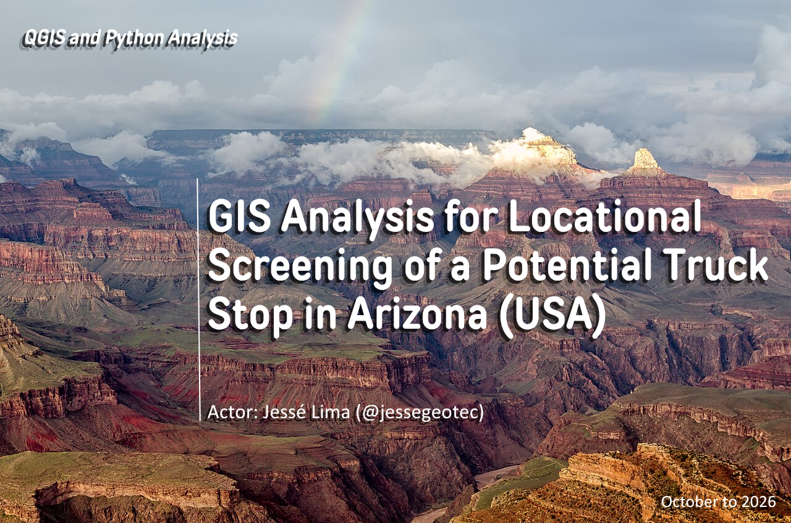
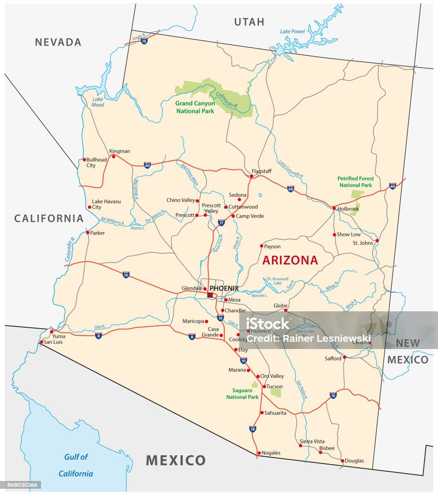
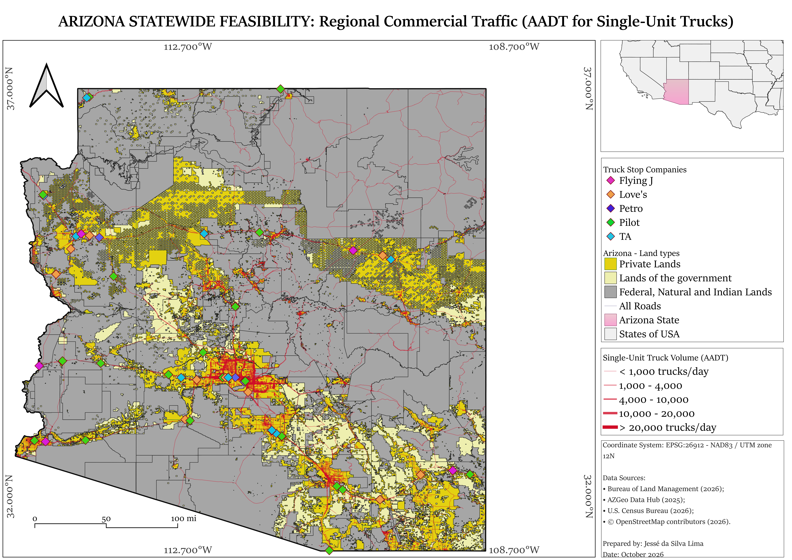
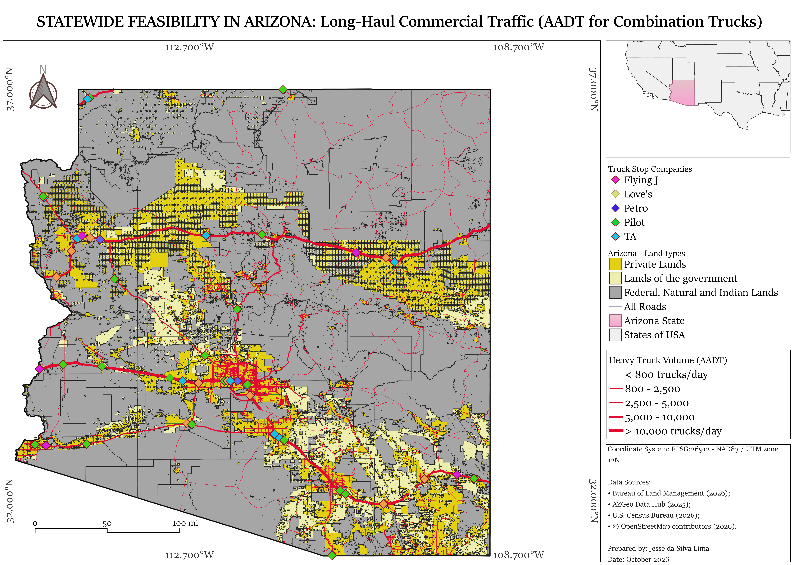
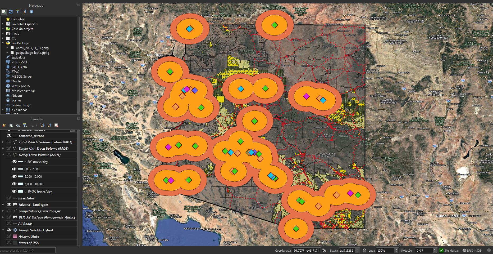
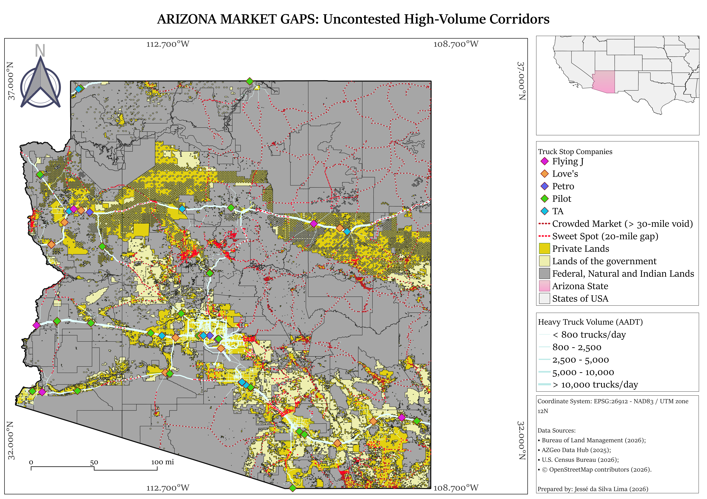
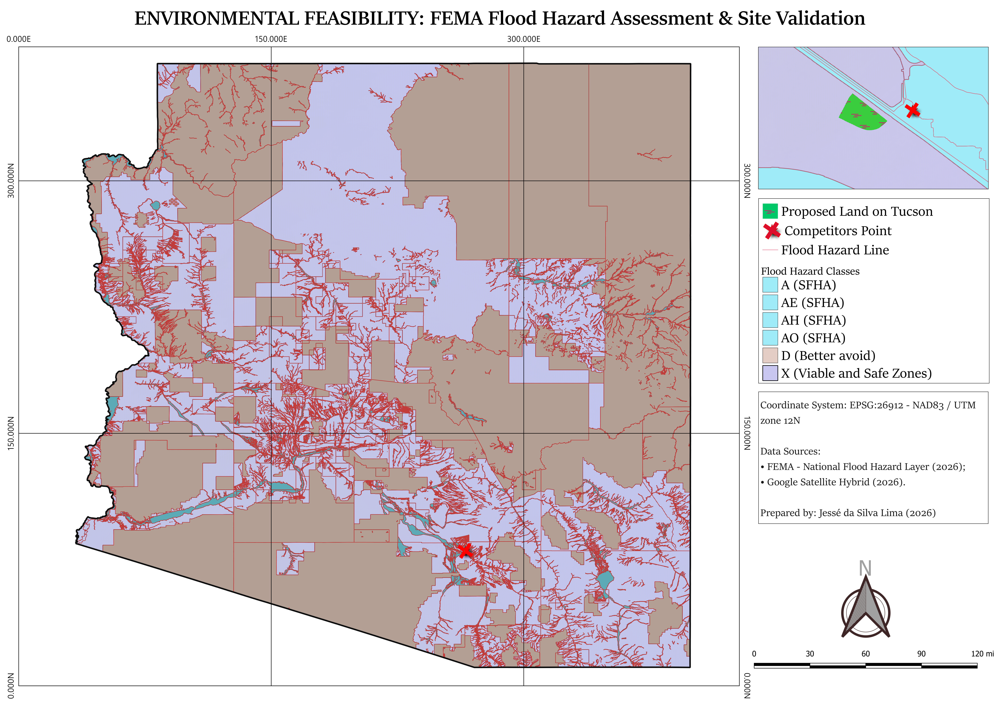
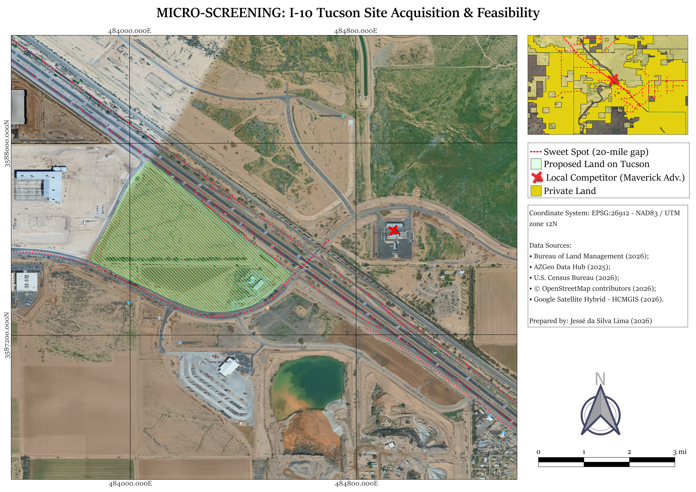

[🇺🇸 English](README.md) | [🇧🇷 Português](README-pt.md)

# GIS-Analysis-for-Locational-Screening-of-a-Potential-Truck-Stop-in-Arizona
### Feasibility Research for Truck Stop Construction and Site Acquisition

---

## 1. Context and Objective
- The state of Arizona, located in the United States, has a strong presence of truck stops due to its heavy reliance on road traffic, driven by its geological formation and geographical layout. Consequently, site selection for a new high-capacity truck stop requires a comprehensive spatial study. This study must evaluate not only land acquisition feasibility and spatial capacity but also heavy-duty truck traffic flow and natural disaster risks. The southern and southwestern regions of the state (home to Phoenix and Tucson) consist of low-elevation desert valleys (such as the Sonoran Desert). Although the region is extremely dry and hot most of the year, it is highly susceptible to severe flash floods during two specific seasons (summer and winter), making it mandatory to ensure the selected site is categorized as a safe zone by the FEMA Flood Map Service Center.
- The objective of this repository is to demonstrate applied competencies for the GIS & Land Feasibility Analyst role at KND Fuels. This is achieved through a state-wide spatial analysis workflow followed by a local micro-screening investigation in the Tucson region.
- The project combines traffic data, Python ETL, satellite imagery, territorial constraints, competitor mapping, and site feasibility screening through natural hazard risk assessment (FEMA).
---

## 2. Study Area and Selected Data

*[fonte](https://www.istockphoto.com/br/vetor/arizona-mapa-rodovi%C3%A1rio-gm868030266-144411651)*
- Recorte Espacial: State of Arizona, USA.
- Reference Year: 2025/2026
- The indicators were not selected merely based on data availability, but through a targeted search for reliable, high-quality sources that support evidence-based decision-making for land acquisition. 
- The datasets were gathered to fulfill specific analytical needs:
  - Territorial Context: Organizing land ownership layers to distinguish, at an exploratory level, between private land, public land, and areas with specific restrictions on commercial acquisition.
  - Traffic Assessment: Comparing estimated total vehicle volume with specific regional and long-haul commercial traffic indicators.
  - Competitor Mapping: Compiling 59 data points extracted via an automated Overpass API query, plus 11 complementary points mapped manually (based on official corporate sources and satellite imagery inspection), totaling 70 validated sites after removing duplicates.
  - Proximity Analysis: Generating and dissolving 20-mile and 30-mile radius buffers around competitor locations.
  - Spatial Difference: Isolating road segments and areas that fall outside the geometric zones of influence (buffers) and interpreting them alongside heavy traffic layers.
  - Prioritization and Local Inspection: Analyzing these uncontested zones to narrow down the search and select a specific parcel of land.
  - Constraint Screening: Overlaying FEMA flood hazard zones to rule out high-risk environmental areas.

- The datasets used were:
  - **Bureau of Land Management (2026):** Used for cadastral and land ownership mapping, delineating private lands, government lands, Indian reservations, and federal areas.
  - **AZGeo Data Hub (2025):** The primary source for transportation metrics, providing Annual Average Daily Traffic (AADT) data for long-haul commercial traffic, single-unit trucks, and total vehicle estimates.
  - **U.S. Census Bureau (2026):** Applied to structure territorial grids and state/county boundaries of Arizona.
  - **OpenStreetMap contributors (2026):** Vector basemap used to extract the road network, access routes, and competitor infrastructure geolocations (Flying J, Love's, Petro, Pilot, TA).
  - **FEMA - National Flood Hazard Layer (2026):** Used for environmental site validation, mapping flood hazard classes (e.g., safe Zone X vs. high-risk Zones A/AE) to ensure structural safety.
  - **Google Satellite Hybrid / HCMGIS (2026):** Provided high-resolution orbital imagery to assess the proposed lot in Tucson and adjacent areas at the micro-screening scale.
---

## 3. Cartographic Products 
### 3.1 Arizona Territory: Land, Competitors, and Road Traffic

- Initially, the state of Arizona was classified into three areas (private, government, and federal territories). Furthermore, data points corresponding to major competitors in the truck stop industry were inserted. This division is based on the "BLM_AZ_Surface_Management_Agency" layer from the Bureau of Land Management (2026), consisting of the following groups:
  - **Private Lands:** Private lands only.
  - **Lands of the Government:** County, State, Other.
  - **Federal, Natural and Indian Lands:** Bankhead-Jones Act, BLM, BR, Indian Lands, Local or State Parks, Military, NPS, State Wildlife Area, USFS, USFSW.
- The state-wide feasibility analysis reveals that the highest traffic concentration occurs in the capital, Phoenix, which registers the most intense road flow in the state, with certain segments exceeding 200,000 vehicles daily. The second major volume hub is located in Tucson, the state's second most populous city, establishing a high-density logistical corridor between these two major urban centers. This dynamic was quantified using AZGeo Data Hub metrics published in 2025, which project the Future Annual Average Daily Traffic (Future AADT) for 2026 based on historical traffic behavior patterns.

### 3.2 Road Traffic: Single-Unit Truck Flow

- The regional commercial traffic analysis focuses on Single-Unit Trucks (rigid-structure cargo vehicles without articulation). The map demonstrates that the density of this fleet is heavily concentrated in metropolitan areas for local distribution, with the Phoenix region recording a massive daily truck flow.
- Tucson emerges as the second-largest hub, with urban and peri-urban segments handling between 10,000 and over 20,000 vehicles per day. Beyond internal city circulation, the highway axis connecting Phoenix to Tucson sustains a continuous and elevated flow, maintaining significant volumes of 4,000 to 10,000 trucks daily. This highlights the structural vitality of this specific corridor for short- and medium-haul regional logistics.

### 3.3 Commercial Targeting & Influence Area Buffer Analysis

- Long-haul commercial traffic focuses on heavy combination trucks (articulated vehicles), which are essential for interstate logistics and long-distance freight. The mapping reveals that while major arterial routes cross the state, the highest concentration of heavy road traffic expressively links the Phoenix and Tucson metropolitan areas.
- This metric demonstrates the high reliance on this route for freight transport and validates the I-10 corridor as the most structurally viable zone to intercept long-haul heavy traffic. Given the business objective of developing a new Truck Stop, analyzing the flow of combination trucks is critical, as it indicates potential clients.

Based on these findings, I generated 20-mile and 30-mile buffers around the mapped competitors (represented by diamonds on the map). These competitors were geocoded using a [Python API](arizonaproject.ipynb) pulling from OpenStreetMap data, official corporate websites, and Google satellite imagery inspection.

- The spatial processing consisted of creating 20-mile and 30-mile radius buffers around each previously mapped competitor, representing the industry's major retail networks. A dissolve operation was utilized to merge intersecting polygons, resulting in a continuous geometric footprint that delineates the commercially consolidated influence zones across the state.
- Following this geometric boundary creation, a spatial difference (erase) tool was applied between the Heavy Truck Volume layer and the dissolved competitor buffer zones.

- The Market Gaps map consolidates this spatial exclusion operation. The dashed lines outline the identified market voids, categorized as "Sweet Spots" (a 20-mile gap between competitors, highlighted in bright red) and "Crowded Markets" (voids greater than 30 miles, in dark red).
- The cartographic analysis proves that the I-10 corridor, positioned northwest of Tucson, offers the ideal structural convergence: an extremely high density of logistical traffic (AADT > 10,000 trucks/day) located exactly within a 20-mile "Sweet Spot," completely free from the direct influence of major mapped competitors. This intersection of empirical data geographically justifies selecting this region for micro-scale prospecting.

### 3.4 Feasibility Analysis and Site Selection

- Once the radius of interest on the I-10 was defined, the next step required environmental safety validation against hydrological risks. Using the 2026 National Flood Hazard Layer (FEMA), flood hazard classes were mapped for the state, so I mapping the classes of hazard risk for the State on Arizona that way:
  - **Zones A, AE, AH, and AO (Special Flood Hazard Areas - SFHA):** Grouped together as they represent high hydrological risk areas with at least a 1% annual chance of flooding (the "100-year flood"). This grouping was applied because all these categories impose severe construction restrictions, pose critical risks to the Truck Stop infrastructure, and entail high costs for mandatory insurance and mitigation engineering.
  - **Zone D (Undetermined Risk):** Classified as "better avoid" as it indicates areas where FEMA has not yet conducted hydrological analyses. For site screening and real estate acquisitions, this lack of data introduces incalculable regulatory and structural uncertainty, which can render site development unfeasible post-purchase.
  - **Zone X (Viable and Safe Zones):** Selected as it represents minimal to moderate risk areas located outside the 100- and 500-year floodplains. In the Arizona desert region, which is prone to flash floods, positioning the development in this zone ensures structural viability, operational safety, and eliminates regulatory friction for expanding the yard and facilities.
- A detailed inspection (highlighted in the top right corner) demonstrates that the Proposed Land in Tucson falls entirely within a Viable and Safe Zone.
- This cartographic evidence certifies that the target acquisition area does not intersect Special Flood Hazard Areas (such as the light-blue delineated Zones A and AE). This mitigates structural threats from flash floods and ensures the project's physical and operational viability.
---

# 4. Area of Interest: Tucson Site on Interstate 10

* The final micro-screening stage used high-resolution satellite imagery to assess the site's physical characteristics at the parcel level. The green polygon delineates the proposed expansion area, positioned within the previously identified 20-mile market gap. The approximate location is available via [Google Maps](https://maps.app.goo.gl/DyHQg48xqhwrTh4F7).
* The spatial delineation of the candidate site, including the existing gas station and the adjacent parcel considered for potential expansion, resulted in an approximate area of **23.4 hectares (57.93 acres)**. This figure does not necessarily represent the area that is actually buildable or usable, which requires further investigation into land ownership, zoning, environmental constraints, flood risk, road access, and infrastructure requirements. For reference, the existing gas station within the area of interest occupies approximately **0.7 hectares (1.8 acres)**.
* * The competitor marked with a red X on the map occupies an area of **2.5 hectares (6.22 acres)**. This site provides a reference point for assessing the potential development of a larger facility with more parking spaces and retail services to attract prospective customers.
  * * The land-status mapping indicated that the area is privately owned, potentially enabling commercial acquisition. Its location adjacent to Interstate 10 provides direct logistical access to a high-traffic highway corridor. However, the delineated area of interest includes an existing gas station serving passenger vehicles. The proposed strategy is to acquire the adjacent parcel together with the existing station and develop a competitive truck stop, considering the presence of similar businesses across Arizona.
* The parcel geometry suggests sufficient space to potentially accommodate the turning radii required by large articulated trucks and long-term truck parking infrastructure. This spatial configuration may offer a structural advantage over the smaller local competitor, **Maverick Adv.**, identified nearby. This business was not included in the competitor dataset because the research did not establish an affiliation with any of the major companies selected for the analysis.
---

# 5. Conclusion
This project developed a geospatial analysis workflow for the preliminary site screening of a potential truck stop in Arizona, integrating road traffic indicators, land status information, competitor locations, and flood hazard data. The analysis began with a statewide assessment of freight traffic patterns and existing infrastructure, progressively narrowing the investigation to the Tucson area and a candidate site adjacent to Interstate 10.
Traffic indicators highlighted the Phoenix–Tucson corridor as a relevant route for road transportation and freight movement. Combined with the competitor inventory and the application of 20- and 30-mile buffers, these findings guided the identification of areas beyond the defined geometric proximity zones of mapped establishments. Tucson was selected for further investigation, culminating in the delineation of a candidate area of approximately 23.44 hectares, comprising an existing gas station and an adjacent parcel considered for potential expansion.
- At the micro-screening stage, satellite imagery interpretation, a preliminary assessment of land status, and the overlay of FEMA flood hazard zones provided relevant information for further investigation. The results support prioritizing the site for additional property acquisition and development studies but do not, on their own, establish commercial, construction, or regulatory feasibility.

From a methodological perspective, the project demonstrates the integrated application of GIS, Python-based data processing, proximity analysis, spatial difference operations, and cartographic interpretation to support site-selection decisions. The primary outcome is not proof that the proposed development should proceed at the selected location, but a reproducible screening workflow that narrows the search area and identifies spatial criteria relevant to subsequent decision-making. The site's feasibility remains subject to further validation of the competitor inventory, market demand, road access, zoning, environmental and geotechnical conditions, infrastructure availability, and development costs. The delineated 23.44-hectare area does not necessarily represent the developable area, and FEMA flood classifications do not replace site-specific flood and drainage studies.

Overall, the study presents a geospatially informed site-selection hypothesis and a technical basis for the next stage of investigation. Any acquisition or development decision should be made only after integrating these findings with field assessments, regulatory due diligence, and commercial and financial analyses.

### 5.1 Other Projects & Technical Skills
To explore additional methodological approaches and tools in my portfolio, please visit the repositories below:
- **[Spatial Analysis of Infant Mortality](https://github.com/jessegeotec/Mortalidade-Infantil-no-Acre-e-Seus-Condicionantes-2022):** Integrated application of **SQL** and **GIS** tools to map health indicators and territorial vulnerability.
- **[Origin-Destination Mapping: RAPS Attendance](https://github.com/jessegeotec/Analise-Espacial-do-CAPS-RJ):** Development of a structured **ETL** pipeline and spatial flow mapping using **R**.

### **Thank you!**

[LinkedIn](https://www.linkedin.com/in/jessegeotec/) | [E-mail](mailto:jesselimabiz@outlook.com)
